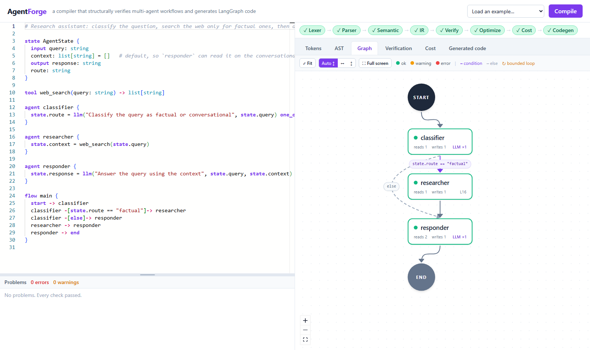

# AgentForge

A compiler for a small language (`.af`) that describes multi-agent AI workflows. It structurally verifies the workflow before anything runs, then generates one runnable [LangGraph](https://github.com/langchain-ai/langgraph) Python file. A web UI shows the output of every compiler phase.

```
.af source → lexer → parser (AST) → semantic analysis → graph IR → verification → optimization → cost analysis → LangGraph .py
```

Compiler Design course project. Every phase is hand written in plain Python (standard library only, no parser generators).



## Why a compiler for this?

A multi-agent workflow is several AI steps ("agents") that share one state, with branches and loops, and every AI call costs money. Written directly in a runtime library, mistakes show up only while running. We wrote the same bugs directly in LangGraph 1.2.16 and ran them:

| Bug | Plain LangGraph | AgentForge |
|---|---|---|
| Edge to a misspelled node | error at `compile()` | AF-E204 |
| Route returns a typo | runs, silently stops | AF-W208 |
| Unreachable node | runs, never mentioned | AF-W301 |
| Node with no outgoing edge | runs, silently ends there | AF-E305 |
| Reading a field nobody wrote | `KeyError` at runtime, after paid AI calls | AF-E302 |
| Wrong type written | runs (`TypedDict` is not enforced) | AF-E203 |
| Endless loop | about 10,000 steps, each possibly a paid call | AF-E303 |
| Loop with no bound | nothing | AF-W308 |
| AI result never used | paid on every run | AF-W307 |
| Untrusted text reaching a refund tool | nothing | AF-W309 |
| Output not written on one path | caller gets an empty value | AF-E304 |

LangGraph catches 1 of these 11 before running. The compiler catches all of them before anything runs, with a line number and, where it applies, the exact path that causes the problem.

## What it checks

- **Syntax**, with error recovery (several errors per run)
- **Types and references**: undeclared tools or fields, type mismatches, wrong tool arguments, non-boolean conditions
- **Reachability**: dead agents, nodes that can never reach `end`
- **Cycles**: loops with no exit and no `max_iterations` bound
- **State completeness**: a field read before it is written on some path, an `output` field missing on some path to `end` (with a concrete witness path)

Four features go beyond the usual checks (details in `docs/novelty.md`):

- **Dead LLM call elimination** (liveness analysis): removes AI calls whose result is never read. On `wasted_llm_calls.af`, 7 calls become 4.
- **Static worst-case cost** (WCET-style): the maximum and minimum number of AI calls per run, computed before anything runs. A loop with no bound is flagged (AF-W308).
- **Prompt-injection taint analysis**: tools tagged `untrusted`, `sensitive` and `sanitizer`; untrusted text that can reach a sensitive tool gives AF-W309 with the exact chain.
- **Choosing between agents** (`compare`): agents that do the same job are scored on test cases and the better one is reported. The compiler first proves that each candidate can replace the one in the flow without breaking verification (AF-E216, AF-W310), measures them on test cases, and wires the best one into the generated code (profile-guided optimization). See [Compare agents](#compare-agents-which-one-gives-the-better-output).

- **Which agents are needed?** (`necessity`): test cases run the whole workflow with and without each agent on a real model, and an agent that makes no difference is removed from the generated code (only agents verification does not need, that call no tool and that do not branch).

These are structural checks. They do not predict what an LLM will answer.

## Results

- 342 automated tests, all passing, including 75 edge cases, mutation fuzzing, and a brute-force check of the cost analysis. Testing found 8 real bugs, all fixed (`docs/testing.md`).
- 8 valid examples compile and run (the largest, `insurance_claims.af`, is 129 lines). 16 invalid examples are each blocked or warned with their expected code. `loan_approval_blocked.af` (132 lines) reports 7 bugs in one compile and generates no code.
- A 3,000-agent workflow compiles in about 0.4 seconds.

Limitations: the AI and tools are mocks in the generated file, cost is counted in calls rather than tokens, taint analysis follows explicit data flow only, and LangGraph is the only target.

## Project layout

```
backend/
  compiler/       the compiler: tokens, lexer, parser, ast_nodes, diagnostics,
                  semantic, ir, verify, optimize, cost, taint, codegen, pipeline, cli
  api.py          FastAPI server (POST /api/compile, GET /api/examples)
  tests/          pytest suite (+ hand written AST fixtures)
frontend/         React + Vite + TypeScript UI (Monaco editor, React Flow graph, cost view)
examples/
  valid/          research.af, fraud.af, support_pipeline.af, insurance_claims.af, compare_agents.af, compare_real_model.af, triage_end_to_end.af, necessity_demo.af
  invalid/        one file per bug class; the first line says which code it must produce
docs/
  contract.md     AST schema, API schema, diagnostic codes, design decisions
  grammar.md      the grammar in EBNF
  explained.md    plain-language explanation of every phase
  testing.md      how the compiler was tested, bugs found, results
  novelty.md      what is new (dead LLM call elimination, cost bounds, taint analysis)
  viva_prep.md    the whole project explained step by step, with likely questions
  slides_assets/  screenshots of the web UI
```

## Setup

Requirements: Python 3.11+ and Node 18+.

```bash
# backend
cd backend
python -m venv .venv
.venv\Scripts\activate            # Windows   (macOS/Linux: source .venv/bin/activate)
pip install -r requirements.txt

# frontend
cd ../frontend
npm install
```

## Run the web UI

Two terminals:

```bash
# 1. API server (from backend/, with the venv active)
uvicorn api:app --reload --port 8000

# 2. UI (from frontend/)
npm run dev
```

Open http://localhost:5173. Pick an example from the dropdown or type your own, then press **Compile** (or Ctrl+Enter).

For the demo you can bookmark an example and a tab directly, for example
http://localhost:5173/?example=fraud.af&tab=Graph or http://localhost:5173/?example=read_before_write.af&tab=Verification.

## Use the command line

From `backend/`:

```bash
python -m compiler ../examples/valid/research.af -o workflow.py
python workflow.py                                   # runs in mock mode, no API keys needed
AGENTFORGE_CHOICE=conversational python workflow.py  # make the mock LLM pick another one_of option
```

Errors are printed like a classic compiler, with line, column, a caret and the witness path:

```
../examples/invalid/read_before_write.af:24:1: error AF-E302: agent 'responder' reads state.context, but on the path start -> classifier -> responder nothing writes it first
    path: start -> classifier -> responder
```

## Run the tests

```bash
cd backend
python -m pytest -q
```

The suite (342 tests) covers the lexer, parser, semantic analysis, each verification pass, the optimizer, cost and taint analysis, and codegen. It compiles every valid example and runs `py_compile` on the output, checks every invalid example produces exactly its expected codes, and (if `langgraph` is installed) runs the generated files.

## Compare agents: which one gives the better output?

Verification proves the workflow is wired correctly. It cannot tell which agent gives the better *answer*, because that depends on the model. So the compiler treats it like **profile-guided optimization**: measure the candidates on test cases, then generate code that uses the best one. It works on any workflow: add a `compare` block (see `examples/valid/compare_agents.af`, `fraud.af`, `support_pipeline.af`):

```
compare best_responder {
  candidates responder_a, responder_b
  case {
    state.query = "What is the capital of France?"
    expect state.response contains "Paris"
    mock responder_a "The capital is Lyon."          # the scripted answer, used in mock mode
    mock responder_b "Paris is the capital of France."
  }
}
```

1. **Verify.** The compiler re-runs the whole verification with each candidate in place of the one in the flow and reports anything new (AF-E216 error, AF-W310 warning). So whichever candidate wins, nothing it verified is lost.
2. **Score.** Each candidate runs on each test case; the one that passes the most wins (a tie keeps the agent already in the flow).
3. **Select.** The optimizer wires the winner into the generated LangGraph code (`'responder_a' replaced by 'responder_b'`). A winner that would add a verification warning is not applied. `--no-select` turns this off.

The scores come from the answers scripted with `mock` by default, so this is offline and repeatable, but it only shows the mechanism. To measure a real model, put your key where the compiler can read it and compile with:

Put your key in `backend/.env` (copy `.env.example`, which lists the variables). `.env` is git-ignored, the compiler and the generated files read it automatically, and variables already set in your terminal win over it. Never paste a key into a chat, a source file or a commit.

```bash
cd backend
copy ..\.env.example .env           # then open .env in an editor and fill in OPENAI_API_KEY (macOS/Linux: cp)
python -m compiler ../examples/valid/compare_real_model.af -o workflow.py --profile real
```

The compiler runs the test cases against the model (paid API calls, only when you ask), then recompiles with the winner. Running `workflow.py` prints the PASS/FAIL table for every candidate; `AGENTFORGE_LLM=real python workflow.py` runs the workflow itself against the model, and `AGENTFORGE_USE_BEST=1` re-picks the winner at run time. The UI's **Evaluation** tab shows the same table and what the optimizer did, and (when the server has a key) a "Measure with a real model" button that shows how many calls it will make and asks first.

Two more lines make this stronger (see `examples/valid/triage_end_to_end.af`):

- `end_to_end` judges each candidate by the **final output of the whole workflow**, not its own text, because a bad answer damages every agent after it. In that example a loose prompt answers "This message is urgent." instead of "urgent", the router does not match it, and an urgent ticket is silently queued; measured with a real model it scored 2/4 against 4/4 for the strict prompt.
- `ensure <condition>` is a run-time check on the wired agent: with a real model, an answer that fails it makes the run fall back to the next candidate (and stop with an error if none passes) instead of passing a bad value on.

## Which agents does the workflow need? (`necessity`)

Every agent costs paid LLM calls, but an agent can be useless in practice: the final answer is just as good without it. A `necessity` block holds test cases (see `examples/valid/necessity_demo.af`):

```
necessity trim_workflow {
  case {
    state.question = "What is the capital of France?"
    expect state.answer contains "Paris"
  }
}
```

With `--profile real` the compiler runs the whole workflow on every case, once as written and once with each agent left out. An agent whose removal does not make the final output worse is removed from the generated code:

```
necessity trim_workflow (real model): the workflow as written passes 3/3 cases
  drafter: needed (0/3 without it)
  reviewer: not needed (3/3 without it); removed from the generated code, saving 1 LLM call(s) per run
  finisher: structural: without it verification fails: output state.answer is not written on the path ...
```

Which agents can be tested is decided statically. If skipping an agent breaks verification, the program itself proves it is needed (no model call). Agents that call a tool (tools are stubs and may have real effects), that choose the next step, or that are compare candidates are never removed automatically. It only removes on evidence (nothing is tested if the workflow as written passes no case) and only for the cases you wrote. Without a model the report shows the static part only. The UI's Evaluation tab shows it too, with the same "Measure with a real model" button.

## The language in one example

```
state AgentState {
  input query: string               # supplied by the caller
  context: list[string] = []        # default value
  output response: string           # must be written before end
  route: string
}

tool web_search(query: string) -> list[string]

agent classifier {
  state.route = llm("Classify the query", state.query) one_of ["factual", "conversational"]
}
agent researcher { state.context = web_search(state.query) }
agent responder  { state.response = llm("Answer using the context", state.query, state.context) }

flow main {
  start -> classifier
  classifier -[state.route == "factual"]-> researcher
  classifier -[else]-> responder
  researcher -> responder -> end
}
```

Bounded loops: `analyst -[not state.confident, max_iterations 3]-> analyst`.
See `docs/grammar.md` for the full grammar and `docs/contract.md` for all diagnostic codes.
